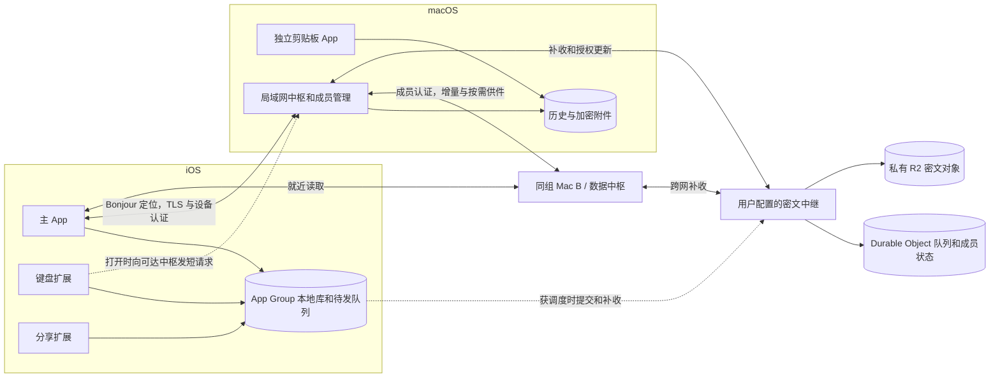

# 随贴（ClipRelay）iOS 与 macOS 剪贴板项目设计

状态：**编码前评审稿 v0.3，2026-11-18**。首发交付独立的 iOS 和 macOS 两端，以及可选的自建云端中继。评审依据为用户提供的七张截图、ClipNote 现有 Worker、AuvCast `583b1da` 的源码及文末平台文档。文中的容量、时延、设备数及系统版本均为拟定值，尚待实测。

**用一条完整路径理解产品。** 在办公室 Mac A 复制富文本，iPhone 切入随贴 后从同网 A 取得记录。回家打开 Mac B，B 可从开启的云端补收密文；iPhone 随后可从家中 B 实时取回原件。两台 Mac 都能承担中枢职责。云端关闭时，只要存在连续可达的已配对 Mac 链路，设备仍可接力转发；链路断开则排队，界面显示最后一次持久化的位置。

## 1. 产品范围

| 交付物 | 首发职责 |
|---|---|
| 随贴（ClipRelay）iOS 版 | 主 App 管理完整历史、设备、配对、云端、导出和隐私设置。键盘扩展默认打开剪贴板，提供基础中英文 26 键。分享扩展负责从其他 App 收取图片、文件和可识别的富文本。 |
| 随贴（ClipRelay）macOS 版 | 从 AuvCast 剥离出的独立菜单栏 App，包含剪贴板历史、预览、复制和回贴、迁移和备份。内置局域网中枢，管理设备身份、授权和补收。 |
| 可选云端中继 | 用户可关闭，或配置自己的 Cloudflare 中继。它负责密文保存和短期转发。既有 ClipNote 网页的账号和历史仍走独立的数据链路。 |

建议起步支持 iOS 17+ 和 macOS 14+，以 AuvCast 的 macOS 14 基线及 Apple SDK 真机验证结果定案。两端首发均须支持至少 7 种界面语言，并提供浅色和深色外观。Android、Windows、九宫格、语音、手写、滑行输入、AI 和云端候选留在后续范围。首发支持一组多台 Mac 和多台 iOS 设备。设备身份与 IP、主机名、当前中枢均无关；换网、重启和更换服务节点均保留配对。

| 角色 | 权限和离线行为 |
|---|---|
| 组管理员 | 首台 Mac 建组，生成稳定的 `groupID` 并固定组信任根。某一时刻只有一台管理 Mac 签发成员清单、邀请和撤销，可显式移交给另一台已授权 Mac。 |
| 数据中枢 | 任一已配对 Mac 均可启用。接收、持久化、提供分页索引、供件、补收和转发；多台可同时服务。管理 Mac 睡眠时，其他节点在有效授权期内继续既有成员的传输。 |
| 成员设备 | 每台 Mac 和 iPhone 有自己的身份。组内共享记录逐设备授权解密；仅本机记录留在原设备。iPhone 使用附近中枢，不承担常驻转发。 |
| 云端中继 | 两端显式启用同一组的服务配置后可使用。持有设备公钥、必要的路由元数据和密文，不能签发成员或解开内容。 |

## 2. 界面与操作

参考搜狗截图里的剪贴板与常用语分段、长内容展开、批量选择、分组设置、键帽大写和中英文切换。随贴使用自己的图标、布局和颜色。参考截图只在本机审阅，示例内容不进入项目。

| 参考截图（文件名尾部） | 随贴的具体取舍 |
|---|---|
| 10.52.13 | 默认显示剪贴板／常用语与数量。点正文执行该类型的操作；点展开看完整内容、来源和附件状态；批量选择后再删除或导出。 |
| 10.52.45 | 采用三行 26 个大写字母、Shift、删除、数字符号、中英切换和宿主返回键。工具栏最易触及的位置给剪贴板，地球键切换系统输入法。 |
| 10.53.40 | 主 App 将设置分为输入与键盘、剪贴板与缓存、设备与同步、备份与隐私。设备和同步在首页也有入口。 |
| 10.54.26 | 中文首发做本机全拼、候选、翻页、空格上屏；把模糊音、双拼和云联想放在后续评估。 |
| 10.54.38 | 英文首发做基本补全、Shift 和手动锁定大写；自动空格、句首大写为可关闭偏好。键帽始终大写，输出大小写由输入状态决定。 |
| 10.54.52 | 保留无障碍焦点顺序、剪贴板和常用语设置入口。文本替换可从常用语显式插入。 |
| 10.55.07 | 设置中可预览键盘外观、候选字号和按键反馈。候选栏提供剪贴板按钮；显示最近内容摘要需用户主动开启，避免在宿主 App 中意外展示私人内容。 |

| 界面 | 信息和操作 |
|---|---|
| iOS 键盘默认页 | 顶栏左侧为「剪贴板／常用语」，右侧保留「键盘」入口及筛选按钮；窄屏时将筛选移入菜单。最多展示一至两行摘要及类型、来源和时间；点文本行直接插入，点末尾展开按钮查看详情、收藏、删除或复制。底部保留系统切换键，网络和自动发送状态只在有变化或需要处理时突出。 |
| iOS 26 键 | QWERTY 大写键帽，中英切换与地球键分别控制。中文支持本地全拼、候选翻页、选择／空格上屏、输入组合删除；英文支持大小写实际输出、空格、删除、换行和基础本地建议。长按或 123 面板提供数字、标点。候选栏固定留剪贴板入口，切换视图时保留当前拼音组合。输入语言与界面语言独立。 |
| iOS 主 App | 「历史」「设备」「设置」。历史支持全量搜索、预览、选中、批量删除／导出、标签、收藏和常用语管理；设备页扫码、发现、检查指纹、撤销。权限、同步、云端、容量、主题、语言、导出和诊断集中在设置。 |
| iOS 分享扩展 | 显示类型、名称与大小。提供「保存到随贴」「发送到已配对设备」。附件先落入 App Group 暂存并建立队列，充分时间内立即尝试发送；扩展退出时保留已落盘任务，主 App 后续续传。 |
| macOS 独立 App | 菜单栏和可配置全局快捷键打开浮层。左列是类型和设备筛选，中间是列表，右列按需显示详情和来源。支持预览、复制、粘贴到原 App、置顶、标签、批量管理、打开配对二维码、从 AuvCast 或 iOS 导入、归档与诊断。默认尊重无自动控件焦点的偏好，Tab 导航，Escape 取消或关闭。 |

筛选维度：所有／收藏／常用语、文本／富文本／图片／文件、来源设备、局域网／云端／本机、时间范围、标签、下载状态。一期对主 App 和 Mac 提供组合搜索，键盘先提供类别、收藏和来源三个快速筛选，只有在焦点进入主 App 后才使用独立搜索输入框。剪贴板列表和常用语使用相同的条目操作，常用语为用户显式保留的条目，不随普通历史过期清除。

## 3. 国际化、主题和无障碍

- **产品显示名。** 中文显示「随贴」，英文及其他界面语言统一显示「ClipRelay」。两端 App、键盘与分享扩展的显示名、菜单及设置页面遵循同一规则。
- **界面语言。** iOS 与 macOS 各自至少支持 7 种语言。建议首发中文、英语、日语、韩语、德语、法语、西班牙语。中文同时提供简体和繁体，共 8 套本地化资源（`zh-Hans`、`zh-Hant`、`en`、`ja`、`ko`、`de`、`fr`、`es`）。日期、相对时间、文件单位和复数使用对应地区格式。
- **语言匹配。** 默认跟随系统，按用户的首选语言顺序匹配 BCP 47 标签，识别文字体系和地区变体，例如 `zh-TW` 匹配繁体中文、`fr-CA` 匹配法语。全部首选语言均无匹配时回退英文。两端也可手动指定界面语言；所选资源缺少某条文案时，该项使用英文源文案。
- **iOS 输入法。** 只提供中文全拼 26 键和英文 QWERTY 26 键，键帽始终大写。界面语言只影响菜单、按钮与提示，不改变当前输入模式、候选语言或剪贴板原文。
- 用 String Catalog 分发本地化资源。iOS 主 App、键盘、分享扩展和安装／权限文案都纳入覆盖。语言和主题偏好放在 App Group；扩展激活时读取配置快照，避免依赖主 App 常驻。Mac 菜单栏、浮层、设置、权限、导入导出、错误和诊断均覆盖。
- 两端均提供「跟随系统／浅色／深色」，默认跟随系统。系统动态色或语义色统一定义背景、键帽、候选高亮、选择、同步错误和不可用状态。同步状态用图标加文字，避免用颜色作为唯一信号。iOS 键盘还应兼容宿主期望的键盘外观，显式主题优先。
- 验收覆盖 VoiceOver、动态字体、Mac 键盘导航、增大对比度，以及最长语言的截断回归。键盘保持 26 键和键帽大写，窄屏时优先收纳工具入口和状态辅助文案。

## 4. 架构和技术选型

Swift 为两端核心。共享 Swift Package 放协议版本、模型、加密封装、归档、传输和 SQLite 接口。用 SwiftUI 或经过验证的 OpenSwiftUI 兼容子集组织视图，iOS 键盘生命周期、`textDocumentProxy`、分享和系统粘贴桥接使用 UIKit，Mac 菜单栏窗口、剪贴板和系统辅助权限使用 AppKit。优先复用 AuvCast 现有可拆代码。用 Network.framework 的 Bonjour 发现和 TLS 连接，复用成熟的 HTTP 实现或可审计的 Swift 服务端组件，避免自己实现 TLS、HTTP 解析与密码原语；不为首发额外引入 Go 常驻进程。iOS App Group 中的 SQLite 使用 WAL 和短事务，所有写入可跨进程竞争；Swift actor 只保护单进程，跨进程一致性由数据库事务与暂存文件原子提交负责。App 与扩展共享独立 Keychain 访问组，并使用设备锁定时不可用的保护策略。

LAN 首选 HTTPS 请求、游标增量和前台长连接通知或有界轮询。首发先用 HTTPS 加游标轮询跑通，只有性能数据支持时再增加 WebSocket。Mac 单进程内运行中枢，可以从菜单栏开关。Mac 退出、休眠、系统防火墙或 Wi-Fi 隔离可能让本地连接中断。键盘扩展开启期间可短连接补收，小文件可在当前操作取回；稳定补收由主 App 在前台及系统实际给予的后台时间内负责。

## 5. 发现、扫码、直接输码和地址变更

1. Mac 首次启动生成 `hubID`、签名钥、TLS 服务身份，使用 Keychain 持久化。Bonjour 广播 `_clipnote._tcp`，TXT 只放协议版本和不含设备名称的匹配标识。主 App 首次开启配对时请求相机和本地网络权限。用户可点自动发现的中枢，也可直接扫码或手填地址。
2. 二维码包含 `hubID`、协议版本、当前本地连接提示、TLS 公钥指纹、短期随机挑战和过期时间。二维码只是配对引导，地址仅供连接，不是身份。自动发现路径需要 Mac 和 iPhone 同屏核对一次性短码，或者最终扫描二维码；未确认的广播不可直接授权。挑战一次性消费，建议 120 秒失效，配对端点限速。
3. iOS 连接中枢，先验证 TLS 公钥指纹，再提交设备加密和签名公钥以及一次性挑战。Mac 显示待加入设备并确认，签发设备成员凭据及当前成员版本。客户端记录 `hubID`、公钥摘要、最近地址、自己的 `deviceID`，同时启用签名请求或短期会话。导出与迁移不会带出配对私钥。
4. 下次启动根据 `hubID` 浏览和解析新地址，优先尝试最近可用端点，再用 Bonjour 更新的 IPv4／IPv6 地址并行重连。连接失败时退避、监听网络变化并主动刷新；识别新地址后必须再次验证固定公钥。Bonjour 被禁时提供手填新地址，配对关系保持。防止旧 IP 被其他设备占用时误连。
5. 每个中枢有独立的 `hubID` 和 TLS 身份，同组共用 `groupID` 和签名成员清单。已入组的客户端发现新 Mac 时，用清单验证其服务身份和中枢权限。该设备原签名钥签署的声明加上有效成员授权可用于计划内 TLS 轮换。身份私钥丢失的设备作为新成员重新加入，其他设备保留组配对。

### 5.1 两台 Mac 直接通过配对码入组

管理员在「设备 → 添加 Mac」选择同网或跨网。邀请中分别包含公开的房间定位符、短期秘密和到期时间；界面把定位符与秘密排为一串可手输的配对码。局域网由 Bonjour 定位邀请端。跨网时双方必须开启云端，同意使用同一服务地址；使用自建服务时要另外提供地址或扫描包含服务地址的邀请。短码本身无法发现任意自建服务器。

在 LAN 或通过 Worker 转发握手消息，使用经审阅的标准 PAKE 实现（候选 SPAKE2，RFC 9382）。只有房间定位符送给中继查找，秘密留在两端；不要把短码放进 URL、日志或当成长期访问令牌。双方用密钥确认绑定会话、协议版本、组根指纹、双方设备公钥和角色，再显示一致的校验词及设备名，由管理 Mac 批准。邀请建议 2 分钟过期，最多 5 次失败，成功原子核销；签发成员证书丢包时仅允许同一已验证会话恢复原结果。取消、到期或拒绝均不建立成员关系。若原型阶段找不到合适库，跨网输码作为发布阻塞项；可先交付高熵二维码路径，禁止把普通验证码交换作为安全替代。

Mac B 入组后可以选择「将此 Mac 用作中枢」，由管理员签发服务角色，并在设备页显示 B 的配对、可达和供件状态。两台已有独立组的 Mac 不会因互输一次码自动合并原有成员和历史；首版加入另一个组应独立保存两组边界，在界面选择活动组，迁入旧记录需明确选中导入并重新加密。每个记录、缓存键、队列与路由请求都绑定组 ID。

### 5.2 管理权和故障切换

发现和数据传输可经任一有资格的 Mac。新增、撤销和权限移交由当前管理 Mac 批准；非管理员中枢能转交申请，管理员离线时显示「等待批准」。计划内移交要求旧管理 Mac 与接任 Mac 同时在线，旧端持久化唯一后继、签下绑定新管理公钥、上代摘要和递增代次的交接声明，随后停止用旧代签发；接任端完成密钥持有证明并发布新的授权链。节点保存最高已验证代次，拒绝回滚，遇到同代不同清单暂停管理变更并提示恢复。首发不在断网分区自动选举管理员。唯一管理钥永久丢失时，可用存活成员本地可解密的归档创建新组并重新配对，旧云端密文不会自动恢复。这一取舍避免两台离线 Mac 分别批准互相矛盾的成员。

## 6. 设备加密和权限

| 层 | 初始设计 |
|---|---|
| 身份 | 每台设备独立生成 Swift CryptoKit X25519 接收公钥和 Ed25519 签名钥，私钥留在设备 Keychain；中枢签署包含成员公钥、权限、成员版本、过期时间的成员清单。签名绑定中枢、设备、条目、版本和密文摘要。 |
| 内容 | 每个条目生成随机内容密钥，正文、文件名、标签、缩略图、富文本和附件在发送端使用验证加密。附件按有界块加密，认证数据包含条目 ID、表示类型、块序号和版本；保证同一密钥下 nonce 不重复。入库、下载和导入先校验签名、完整性、长度及权限，再作为可用条目发布。 |
| 接收者 | 使用经官方 SDK 或成熟库能力验证的 HPKE（RFC 9180）为当前授权设备逐个封装内容密钥。包括发送设备本身以及作为成员的 Mac。中枢转发给已配对成员，云端只接触信封、密文和路由所需的最少元数据，包括不透明 ID、密文大小和时间。所有设备默认共享同步内容，私密／仅本机记录不进入该组。 |
| 传播和撤销 | 只有当前管理 Mac 可签署成员变更。撤销后拒绝相应会话和读取令牌，发送者刷新清单并为新内容按最新成员重新封装。中继收到并验证更新后原子应用，拒收旧版本新写入。成员清单到期或版本无法确认时，新内容留在本机队列，等待有效授权。已被下载或解封的数据不会因撤销被远程回收。 |
| 新设备与历史 | 默认收到配对之后的新内容；Mac 可显式批准把指定旧历史共享给新设备，前提是 Mac 仍持有相应历史的解密能力。支持单独的「仅本机」条目、来源 App 排除和发送前的敏感条目策略。 |

安全输运用 TLS。云端自定义只接受可信 HTTPS，任何 URL、密钥或配对码不得写日志。中继地址、账户与凭据可在设置更换；Mac 下发签名配置变更，iOS 也可手填服务地址并验证同一组的信任链。Cloudflare 部署管理的 API Token 不进入客户端。首发按每组最多 12 个活跃设备设计，保持逐设备封装体积可控。正式实现前以 RFC 向量、双端互操作、撤销竞态和并发上传测试验证协议，不实现自定义密码算法。

## 7. LAN 优先和云端补收

| 状态 | 行为 |
|---|---|
| LAN 可达且身份验证成功 | 写入本机待发队列后发给 Mac，收到持久化 ACK 标记已送达。云端开启时，可由 Mac 将同一密文转存中继，供不在同网的成员补收。LAN 仅用模式不建立云端连接。 |
| LAN 不可达，云端开启 | 建议交互预算约 1–2 秒用于已知地址快速探测。随后通过中继获取成员版本，确认授权有效后提交或拉取密文。Mac 离线时，中继可在最后一次签发的有限授权期内托管队列。授权期过或中继也不可达时保持待发。 |
| LAN 不可达，云端关闭 | 本机历史与打字仍可用，传输在本机排队。网络变化、主 App 激活和手动重试触发重连。 |
| LAN 恢复 | 先核验中枢身份，再优先用 LAN 提供新请求。已经完成的云端上传不重复发送内容。在 Mac 合并云端记录并落盘后，同一条事件可用 LAN 补收。 |

每次写入有稳定 `operationID` 和 `entryID`；LAN 和云端各自维护递增游标及 ACK，不比较设备壁钟判断进度。重复提交返回同一结果，重复接收只刷新可用性。内容事件保持不可变，收藏、置顶、标签等修改分别按字段比较由签名覆盖的逻辑计数和设备 ID。计数在本机持久化，生成下一次变更时递增，并追上已观察的最大值。用户删除有墓碑并压制旧副本复活，删除优先。游标推进和条目落库同一事务，断线、重启可续拉。过旧游标由 Mac 中枢按授权提供快照和新的同步水位。首次开启云端只处理启用后的同步内容，旧历史回填需要显式选择。

协议最小接口以 `/v1` 版本前缀组织，包含配对房间与确认（可由中枢或云端传递，入组由管理员最终签发）、取签名成员清单、提交事件、分页取增量、上传／下载分块、取快照及健康检查。组、成员、附件和操作 ID 都作为不透明标识，逐请求验权；签名证明绑定方法、路径、请求摘要及防重放值，或由相同设备身份换取短期会话。已提交的对象与同一个 `operationID` 重试幂等，同 ID 不同摘要返回冲突。同步状态区分「已保存在本机」「待发」「已到中枢／云端」「已在此设备可用」「附件已过期」。中枢 ACK 或中继 ACK 只表示该站持久化，不宣称其他设备已接收。

Cloudflare 方案建议独立部署。Worker 做协议入口、设备请求认证、限流与密文流式转发。每组一个 Durable Object，维护由当前管理员签署的成员版本、序列、去重和到期索引。私有 R2 存密文，不挂公开桶，不把附件写入 D1。至少限制请求体、设备速率、组配额、暂存期和对象权限。对象先暂存并校验提交条件，再发布队列事件，失败或超时清理孤儿；有效期内可重复拉取，不能因首台设备确认就回收。首发由 Worker 中转已授权的流式上传／下载，性能不足再考虑短期预签名 URL。配置板至少有「关闭云端」「自己的 Worker 地址」「连接测试」，展示加密状态、过期和额度。中继由 Mac 首次登记组及根公钥，登记使用部署者生成的一次性凭据；iOS 根据中枢签名配置接入。建议独立 Wrangler 配置与存储，不复用网站会话 Cookie。

### 7.1 多 Mac 的发现、接力和带宽

- **选择路径。** 优先取已验证的本机副本，其次找同网且声明持有该对象的已配对 Mac，再尝试由局域网可达 Mac 提供的接力，最后使用已开启的云端。节点交换短期、经认证的可用性摘要。用近期成功率、往返时延和实际字节吞吐选同优先级来源，给当前来源短暂稳定期，避免在两台 Mac 间来回切换。发现同名 Wi-Fi 或看见广播都不等于链路可用。
- **先同步索引，原件按需取。** 各 Mac 持久化收到的不可变事件与来源证明，按各自的本地日志序列提供增量。每对节点维护独立游标；断线重连交换各自缺失的事件，不直接复用上一台 Mac 的游标。附件提供者通告对象 ID、密文摘要和可用块，接收者按可用性从一处顺序下载，失败后从另一来源续取缺块。相同原件在同一组重复路由只传缺块，跨组不共享去重索引。原始签名和接收者信封贯穿所有跳，转发者无权增加接收者。
- **约束转发。** 中枢只向同组、已授权、确有缺口的邻居转发。持久化 `(groupID, operationID)` 去重，临时路径记录经过的中枢，实时请求默认最多 3 跳、一次仅选一条有效路线，失败才切换。周期性增量对账负责长时间分区后的收敛。附件缓存设置并发上限、磁盘水位和逐设备速率；同一对象的并发下载在单台 Mac 合并。只有原件和必要信封都落盘才发附件可用 ACK，收到摘要仅发索引 ACK。中继能跨越现有可达链路或携带缓存移动到另一网络；没有任何可达边且未开云端时，无法实时跨网。
- **撤销窗口。** 建议成员清单离线租约先定为 15 分钟。已获知撤销的中枢立即拒绝该设备，未获知变更的分区最多按旧租约服务。设备保存最高成员代次；超过租约、时钟明显回拨或无法证明授权有效时，只保存本机待发。重连先拉成员变更，再传数据；旧代待发保留本机原件，用新内容密钥和有效收件名单重建加密事件。该机制不能收回旧密钥已解开的内容。需要更严格时可选择每次发布都向管理员在线核验，以牺牲分区可写性换取更短撤销窗口。
- **云端变更。** 设置项包含服务 URL、组指纹、启用范围、云端 TTL 与配额（服务端策略为上限）。「测试连接」依次报告 TLS、协议版本、组身份、凭据及剩余额度。换服务先验证新端、签发带版本的新配置，再切换新写入；旧服务可在原 TTL 内只读补收。关闭后停止此设备的云端读写，另设组级「停止并清除云端副本」，由管理员确认并展示未补收设备。局域网优先不代表永不出网：组级启用云补收时，健康的本地写入也可异步备份密文；仅本机和仅局域网记录禁止上传，Mac 接力遵守相同策略。

## 8. 内容格式、大小和粘贴

建议将「10M 以内」定义为单条逻辑记录和单个附件的正文、各表示及原始附件加总不超过 **10,000,000 字节**。单次分享多个文件时逐个显示接受／超限结果，每个文件当成独立条目并限制批次。压缩、Base64、分块都不能绕过明文限制，传输端另设有界密文开销；来源大小未知时流式计数，多读一字节即可拒绝。默认纯文本可先以 256 KiB 为编辑上限、剪贴板仍接受上限内有效文本。错误要说明大小、格式或缓存空间原因。

| 类型 | 收入 | iOS 输出 | macOS 输出 |
|---|---|---|---|
| 纯文本／链接 | iOS 授权读取或分享，Mac 监听／手动复制。保留 UTF-8 和换行。 | 键盘 `textDocumentProxy.insertText` 直接插入，或复制到系统剪贴板。 | `NSPasteboard` 写文本，支持复制或经授权回贴原 App。 |
| 富文本 | 支持 RTF、HTML 和对应纯文本表示。按原始字节加密传输；预览禁止加载远程资源或执行脚本。 | 复制可用富文本表示和纯文本回退，由目标 App 执行系统粘贴。键盘直插提供显式「只插入文字」。 | 写相容的 RTF／HTML 和纯文本表示，目标应用决定是否保留样式。 |
| 图片 | iOS 分享扩展读取 `NSItemProvider`，支持 PNG、JPEG，HEIC 保留原始表示并按需生成可绘制预览。Mac 从剪贴板或文件导入。 | 下载并校验后写图片类型到 `UIPasteboard`，由用户在支持的目标 App 粘贴。另提供分享。 | 写原始图片表示及可兼容的图片类型，支持 Quick Look。 |
| 文件 | 分享扩展或文件选择器收到临时 URL 时，权限有效期内流式复制实际内容并确认类型、大小。Mac 复制 Finder 文件后可显式发送，远端从不收到本机路径。 | 可尝试用目标支持的表示准备系统粘贴，兼容性以真机矩阵为准。通用路径是下载到临时受保护位置，再用分享面板或「存储到文件」交给目标 App。 | 保存为受控缓存里的本地文件，写文件 URL 给目标应用，并保留临时文件直到上游约定的租约到期。 |

键盘中附件的状态为「可复制／需要下载／下载中／过期或不可访问」。点击后按本机缓存 → 局域网中枢 → 已配置云中继读取；校验分块和最终摘要后才写系统剪贴板。下载时不覆盖现有剪贴板，取消、扩展退出和目标不支持时给可重试或在主 App 打开的提示。附件与同一条目中的纯文本只按用户选项输出，不把预览／URL 当原文件复制成功。iOS 目标 App 是否接受富文本、图片或文件由其自身能力决定，键盘扩展没有通用的文件插入接口。

**按需取件实例。** iPhone 的图片原件已被淘汰，只剩缩略图。用户点「取回并复制」，客户端先询问附近 Mac B，B 有缓存就直接供件；B 只有索引时可向 Mac A 请求，仍不可达再从允许的云端取。显示进度和取消按钮，断网后保留已验证的块与短期任务。成功后仅在用户操作仍有效、扩展仍活跃且剪贴板未被更新时执行复制，否则提示「已下载，点此复制」。宿主是否接受该类型由用户在目标 App 执行粘贴验证，不伪造粘贴成功。所有来源已过期显示「原件不可用」，保留摘要与导出选项。

## 9. 保留、分页与诊断

| 项目 | 建议默认值与策略 |
|---|---|
| 键盘列表 | 首次取 10 条，滑到末尾预取下一页。内存保留当前页和相邻页，页面按筛选条件和数据版本缓存。启动只读取本地摘要，不等待同步，不预载原图或附件。 |
| iOS | 最近 200 条普通历史或 30 天，已下载附件默认 150 MiB，缩略图 20 MiB；缓存按最近访问淘汰。低磁盘主动降额。置顶和常用语保留摘要，附件占空间需明确标示。 |
| Mac 中枢 | 最近 200 条普通历史或 90 天，附件默认 1 GiB，可在设置配置。附件只剩唯一副本、待归档或处于传输／粘贴租约时，不参与普通缓存清理。超额时先释放可重新获取的附件，仍超额则暂停新大文件并提示。 |
| 云中继 | 建议默认 7 天或每组 256 MiB，以先达到者为准。显示已用额度与过期策略。服务端用到期索引和 R2 生命周期清理。中继过期只更新远端可用性，本地缓存回收只释放副本，只有用户显式删除同步条目才产生全组墓碑。 |
| 待发 | 建议每设备最多 200 项或 100 MiB，与历史和附件缓存独立记账。只有云或中枢的持久化 ACK 才移除待发凭据。超限暂停接收新任务，展示重试／取消，不能默默删除唯一副本。 |

数据库表建议 `entries`、`representations`、`devices`、`outbox`、`sync_events`、`cursors`、`tombstones`。保留每个内容表示的长度、类型、密文位置和可用性，条目正文及敏感索引材料受本机加密保护，文件名加密存储。SQLite 对排序、类型、来源、置顶和游标建索引，分页使用 `(time, entryID)` 键集游标，同步时冻结当前翻页边界并提供「有新记录」。本地全文查询优先在主 App 对有界数据分批解密扫描，测量不达标再评估受保护的全文索引；不在键盘进程扫全库，不上传搜索词。后台处理附件、降采样缩略图、加密和迁移，主线程只处理交互和系统必要调用。删除、清缓存及备份要处理 WAL、临时文件和排队对象，缓存回收须与下载／粘贴租约协调。

诊断保留滚动聚合指标：冷启动首条耗时、筛选分页 p50/p95、UI 卡顿、键盘内存峰值、中枢 CPU／能耗、文件吞吐、缓存命中／淘汰、队列深度、回退次数、错误码和补收延迟。iOS 主 App 和 Mac 用 `os.Logger`／signpost，键盘扩展仅记本地低频计数并在压力下丢弃诊断，生产默认没有外部遥测。导出诊断可预览，剔除剪贴板正文、文件名、密钥、配对码、设备名称、IP／URL、精确个人时间轨迹等敏感字段。

性能初始目标，以 iPhone 12 Pro Max 或同级 iOS 基线、Apple Silicon Mac、1,000/5,000 条真实结构样本度量：已建索引时键盘打开到可交互首屏 p95 ≤ 250 ms，键盘本地翻页 p95 ≤ 100 ms，Mac 本地过滤 p95 ≤ 120 ms。同网健康时 ≥ 95% 文本交付在 1 秒内，10 MB 首次传输在协商 Wi-Fi 基线下 p95 ≤ 6 秒。键盘滚动常驻内存先以峰值 < 40 MiB 为工程目标，以最弱目标机的扩展终止实际门槛调整；不将 10 MB 原始数据和解码全尺寸位图同时保留在内存。测试报告必须记录环境和样本，不用目标值代替实测。

## 10. 导出、导入和 AuvCast 拆分

### iOS 导出 → Mac 导入

- 版本化 `.clipnote` 加密归档包含条目、类型表示、标签、置顶、常用语、来源摘要和可用附件。支持选中、筛选集或全库导出，默认排除私密内容。只有远端附件时可在主 App 选「下载后导出」或「仅导出记录」，清单逐项标记附件缺失。默认导出到系统分享或文件选择器。
- 单独的归档口令生成密钥，采用经过审阅的固定参数 KDF、随机盐和分块认证加密，配对密钥、云端凭据和会话不进入归档。格式记录版本和上限，支持流式写文件，不通过内存构建整个全量包。不把可压缩的源文件路径当跨设备附件，拒绝绝对路径、路径穿越、符号链接、压缩炸弹和超预算归档。
- Mac 导入先完成完整性和口令验证，再展示新增、重复、缺附件、被容量限制的条目以及空间需求。去重后合并，冲突明确报告。默认本机导入，用户另行决定是否发送给配对组。提交失败回滚数据库和暂存文件，避免半写入。导入重复两次应幂等，目标库只包含已提交的一次合并，源归档和 AuvCast 数据保持完整。

### AuvCast → 独立应用随贴

| AuvCast 现状 | 拆分处理 |
|---|---|
| `ContentSources.swift` 的 `ClipboardMonitor` 和 `ClipboardPasteboard` 监听 `changeCount`，跳过私密类型和指定应用，文本、文件路径和 TIFF 按现有顺序捕获。 | 保留监听、过滤和复制语义。独立 App 学会读取多种表示并把文件路径转换成用户授权读取的内容。对本应用写回用 change count／自有标记抑制回环，远端入库避免自动覆盖系统剪贴板。 |
| `ClipboardHistoryWindowController.swift` 含浮层、菜单栏表现和大部分列表交互，依赖 `RayonStore`、主题、命令动作和窗口上下文。 | 拆出面板与键盘交互的最小视图模型和 `ClipboardStore`，用独立 AppDelegate、快捷键、设备设置和诊断。回贴需保留原前台应用检查及用户授权，权限不足降级为复制。 |
| `RayonRepository.swift` 把剪贴板历史嵌入 AuvCast SQLite 的全局状态。`ClipboardArchive.swift` 的 `.rayonclip` 是带口令的旧格式，单记录上限 2 MiB、总明文上限 16 MiB。 | 首选用户从 AuvCast 导出、在新 App 用版本兼容导入器读取 `.rayonclip`；旧文件路径在 Mac 本机保留为快照引用，附带「定位／重新选择」操作，无法访问则标明缺附件。新归档另用流式格式，旧格式解析边界不变。独立 App 使用自己的 Bundle ID、Keychain、数据库和目录。 |

迁移验收时保留 AuvCast 原库和旧备份。独立 App 成功导入并核对记录数后，可由用户在 AuvCast 关闭旧监听和冲突快捷键；两个监听同时启用时避免共享数据库和重复推送。迁移交付以可单独安装、卸载和备份的 App 为准。AuvCast 后续是否把原入口换成启动随贴的桥接，作为单独迁移决定。

## 11. 权限与自动发送

- 首次配对由主 App 在前台对系统权限作说明，再触发本地网络与相机权限。局域网拒绝后显示系统设置入口；已经明确启用云端的设备仍可以走云端，未启用的仅本地运行。键盘扩展在关闭「允许完全访问」时，基础本地输入必须可用，共享列表以 SDK 和真机能安全读取的缓存能力为准。
- 默认剪贴板页和默认自动发送是两个设置。建议默认打开剪贴板页，自动读取／发送需用户单独启用，显示目标组和是否会经过云端。切入输入法时只尝试一次，若系统许可且剪贴板版本有变化，则排队同步。用户拒绝时停下自动读取，从主 App 的 `UIPasteControl` 或分享菜单显式导入，避免每次切入反复弹框。输入的字母、词典候选和宿主输入上下文不进入同步或诊断。
- 自动发送先处理合规的纯文本／可识别富文本。机密条目、本机排除的内容、系统已知的敏感标记和掌握的应用排除不发送。iOS 对来源 App 和敏感标记的可见性有限，不能保证识别所有密码和验证码。Mac 的 AuvCast 私密类型过滤和排除表可直接作为起点。图片与文件首发通过用户明确分享或手动发送。
- iOS 的安全文本字段、部分宿主和系统输入场景可能不加载第三方键盘。锁屏、进程被杀和后台任务没有准时执行承诺。键盘扩展激活时和主 App 回到前台补收。系统 pasteboard 授权、扩展网络访问、10 MB 内存边界和 App Store 第 4.4.1 条是发布前需要真机确认的条件。

键盘默认打开剪贴板，始终保留一步切回打字的入口。离线或未授予完全访问时，键盘必须能完成基本中英文输入；相机扫码、云端配置和完整导出由主 App 发起。发布前按当期 App Review Guidelines 4.4.1 评估“提供键盘输入”和扩展独立可用性，连同真实宿主中的打字、拒绝权限和手动粘贴流程一并验收。系统能否无提示自动读取取决于授权状态，不能把键盘切换动作视为用户已经同意读取或上传。

## 12. 开发顺序和验收

| 阶段 | 交付 | 必须通过的检查 |
|---|---|---|
| P0 可行性 | 一台真实 iPhone、Mac 本地验证扩展完全访问、粘贴授权、App Group、真机 Bonjour、RTF／图片／文件路径。验证 PAKE、HPKE 和所选拼音词库的最低系统支持、互操作与授权。 | 键盘切入自动发送行为有录屏和日志证据，拒绝授权仍可打字和手动发送。备忘录、信息、文件 App 及至少一个第三方 App 的类型矩阵。未通过则保留主动粘贴／分享，修订自动发送承诺。 |
| P1 Mac 独立应用 | 提取 AuvCast 剪贴板能力、设置、`.rayonclip` 迁移、首版本地库和局域网中枢。 | 导入备份无丢失，AuvCast 原数据保持。窗口快捷键、Escape、复制与回贴的权限降级准确。单独安装运行。 |
| P2 iOS 主 App 与键盘 | 默认剪贴板、两套大写 26 键、离线候选、常用语、列表筛选和主 App 配对。 | 无互联网的同一 Wi-Fi 下文本双向可用。扫码和自动发现均通过，Mac 换 IP 后重连，无需重配；同名其他中枢和旧 IP 不能冒充。两端分别验收全部首发界面语言及深浅主题。覆盖首选语言全部不受支持时显示英文、法语地区变体匹配法语、中文显示「随贴」和英文显示「ClipRelay」。切到日语界面后，iOS 输入菜单仍只有中文和英文，两者均能输入。 |
| P3 附件与归档 | 富文本、图片、文件分享、10 MB 边界、重新下载、缓存和 iOS 导出到 Mac。 | 10,000,000 字节接受，超一字节拒绝；模拟断流、重复导入、损坏包、磁盘满、缓存淘汰与粘贴并发，确保无破坏和无假成功。 |
| P4 多中枢与可选云端 | 多 Mac 配对和接力、独立 Cloudflare 中继、自定义地址、LAN／云切换、撤销与补收；通过下方多节点验收。 | 断开局域网但保留互联网，Mac 和 iPhone 通过密文中继补收。重回同网优先 LAN，无重复条目。验证伪造签名、已撤销会话、旧成员版本、过期对象、Mac 睡眠和自建地址迁移。 |
| P5 发布 | 性能、隐私、本地化和主题回归，iOS/TestFlight、独立 Mac 签名产物。 | 在用户的实际设备上按指标跑回归，测试均后台完成。Mac 构建走本地 `build.sh`、递增版本号并替换测试机 App，替换确认后清理项目 `.artifacts`。Cloudflare 若部署，走独立本地构建与部署脚本。 |

估算以每个阶段的退出条件为边界，P0 用 2–4 个工程日消除平台风险，其余阶段在 P0 后按是否复用 AuvCast 和词库集成成本重新估算。首发需要完整通过 P0–P5，最早可试用里程碑为 P2。开工前建议先确定最低系统版本、具体首发语种组合、10 MB 定义、初始配额和旧 AuvCast 入口的迁移方式；不影响其他设计部分。做到一半遇到自动读取受系统约束时，保留替代发送路径并在验收中明确区分。

### 多节点发布验收

| 场景 | 预期结果 |
|---|---|
| 同网两台 Mac 输入配对码，第三台未配对但能发现广播 | A、B 均可服务 iOS，第三台不能订阅私有索引、取件或解封内容。错码、过期、重放及重复批准均不重复授予身份。 |
| A、B 在不同网络 | 云端关闭时告知无法通过同网邀请连接；双方启用同一中继后，输码、核对及批准可完成；仅控制中继的一方无法替换设备公钥。 |
| A、B、C 成环，重复转发同一事件 | 每端仅有一条记录，稳定后无重复载荷流量。A 与 C 禁止直连但分别可达 B 时，经 B 取得原件；恢复直连后下一次同类请求优先直接取。 |
| 管理员 A 睡眠，B 更换 IP，iPhone 漫游 | B 保有原身份，在有效授权期内继续服务。iOS 自动重发现，游标正确续传。新增成员等待管理员，租约过期不发布新共享内容。 |
| 共享过程中撤销 C，同时 B 离线 | 在线节点立即拒绝 C，分区行为符合公布的租约窗口；重新联机先更新清单，C 无法解密新代内容。管理员移交、新旧签发链冲突分别测试。 |
| 大小刚好 10 MB 的原件部分下载后来源离线 | 换可用中枢仅取缺块，校验成功才可复制。已有剪贴板内容在失败、取消及用户中途复制新内容时均保留。 |
| 1,000 条手机记录、5,000 条 Mac 记录、多源并发同步 | 逐类型及组合筛选、稳定翻页、内存告警收缩、磁盘满回压、删除墓碑和导出重导不丢条也不复活旧条。按第 9 节记录 p95、流量与能耗。 |

**首轮验证物。** 一份 iOS「系统版本 × 宿主 App × 内容表示」矩阵，一份两至三台 Mac 的配对、失联、撤销和回环测试记录，一份 AuvCast 迁移前后可核对的样本报告。每项记录实际机型、系统版本、能否自动完成、需要的用户动作及失败回退；这些记录决定功能可对外承诺到什么程度。

## 参考资料

- Apple：[自定义键盘开放访问](https://developer.apple.com/documentation/uikit/configuring-open-access-for-a-custom-keyboard)、[输入代理](https://developer.apple.com/documentation/uikit/uitextdocumentproxy)、[系统粘贴控件](https://developer.apple.com/documentation/uikit/uipastecontrol)、[局域网隐私](https://developer.apple.com/documentation/technotes/tn3179-understanding-local-network-privacy)、[App Store 扩展规则](https://developer.apple.com/app-store/review/guidelines/#extensions)、[String Catalog](https://developer.apple.com/documentation/xcode/localizing-and-varying-text-with-a-string-catalog)。
- 密码和中继：[CryptoKit HPKE](https://developer.apple.com/documentation/cryptokit/hpke)、[RFC 9180](https://www.rfc-editor.org/rfc/rfc9180.html)、[Cloudflare Durable Objects 限制](https://developers.cloudflare.com/durable-objects/platform/limits/)、[R2 预签名 URL](https://developers.cloudflare.com/r2/api/s3/presigned-urls/)。
- 本项目：[ClipNote Worker 配置](../wrangler.jsonc)。AuvCast 的 `ContentSources.swift`、`ClipboardHistoryWindowController.swift`、`ClipboardArchive.swift`、`RayonRepository.swift`、`Localization.swift` 位于本机 AuvCast 仓库 `Sources/Rayon`。
- 短码握手候选：[RFC 9382，SPAKE2](https://www.rfc-editor.org/rfc/rfc9382.html)。多 Mac 组拓扑、可转移管理员和缓存水位属于本项目的设计选择。
